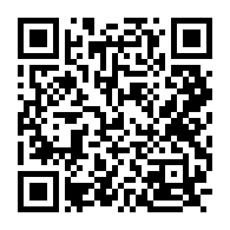

# Classroom Attention Detection

A YOLOv8 object detection model that looks at a classroom photo and labels each student as focused, looking away, on their phone, or sleeping. It also detects empty seats. From the detections we calculate an overall attention score for the class.

**Try it online:** https://huggingface.co/spaces/Ahmed-log/classroom-attention



## How it works

1. We took 68 classroom photos ourselves and labeled every student in Roboflow with one of five classes: `focused`, `looking_away`, `phone`, `sleeping`, `empty_seat`.
2. Roboflow split the data into 48 train, 13 validation and 7 test images, and augmented the training set 3x (horizontal flip, brightness, light blur).
3. We fine-tuned YOLOv8n (pretrained on COCO) for 60 epochs.
4. To evaluate, we matched each predicted box to a real box using IoU of at least 0.5, then used sklearn's classification report and confusion matrix.
5. The model is deployed as a Gradio app on Hugging Face Spaces.

## Results on the test set

| Class | Precision | Recall | F1 |
|---|---|---|---|
| focused | 0.50 | 0.50 | 0.50 |
| looking_away | 0.77 | 0.53 | 0.62 |
| phone | 0.57 | 0.80 | 0.67 |
| sleeping | 0.75 | 0.60 | 0.67 |
| weighted avg | 0.62 | 0.51 | 0.55 |

Out of 35 students in the test photos, the model labeled 20 correctly, gave the wrong label to 7 and missed 8. The main limitation is the small dataset: the training loss keeps dropping while the validation loss stays flat, which shows the model starts to overfit. More photos would be the biggest improvement.

## Files

| Path | Description |
|---|---|
| `CV_Class_Attention_Detection.ipynb` | Full pipeline: data, training, evaluation and attention score |
| `models/best.pt` | Trained model weights |
| `app/` | Gradio app deployed on Hugging Face Spaces |
| `CV_Attention_detection.zip` | The dataset: images and YOLO labels, split into train, valid and test |
| `qr_code.png` | QR code for the online demo |

## Running the notebook

The dataset is included as `CV_Attention_detection.zip` (exported from Roboflow in YOLOv8 format). Keep it in the same folder as the notebook and run all cells. The notebook unzips it automatically. In Colab, upload the zip to the Files panel and set the runtime to GPU first.

## Running the app locally

```bash
cd app
pip install -r requirements.txt
cp ../models/best.pt .
python app.py
```

## Privacy

Everyone in the photos agreed to be photographed and to have the dataset shared publicly. The goal is to measure how engaged a class is overall, not to monitor individual students.
